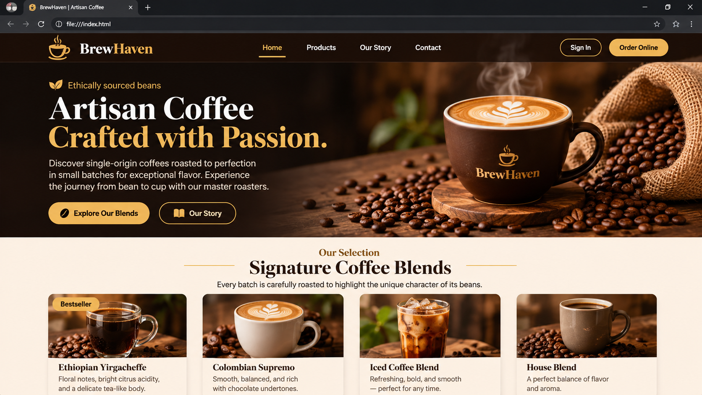

# ☕ Coffee Website

## 📌 About the Project

This is a responsive Coffee Website designed to provide visitors with an attractive and enjoyable experience. The website showcases different coffee products, introduces the coffee shop, and allows customers to explore the available services.

The project focuses on creating a modern, user-friendly design using HTML, CSS, and JavaScript.

## ✨ Features

- Beautiful and modern homepage
- Responsive navigation bar
- Attractive coffee product section
- About Us section
- Services section
- Contact section
- Responsive design for mobile, tablet, and desktop
- Interactive elements using JavaScript

## 🛠️ Technologies Used

- HTML5 – Website structure
- CSS3 – Styling and responsive design
- JavaScript – Website functionality and interactivity

## 📸 Screenshots

Add your website screenshots here.



## 🚀 How to Run the Project

1. Clone this repository:

   ```bash
   git clone YOUR_GITHUB_REPOSITORY_LINK
   ```

2. Open the project folder.

3. Open `index.html` in your browser.

## 📂 Project Structure

```text
Coffee-Website/
│
├── index.html
├── style.css
├── script.js
│
├── images/
│   ├── coffee-home.png
│   ├── coffee1.jpg
│   └── coffee2.jpg
│
└── README.md
```

## 🎯 Project Purpose

This project was created to improve my frontend web development skills and practice building responsive and attractive websites.

## 👩‍💻 Author

**Hawi**

- GitHub: [My GitHub Profile](https://github.com/hawi199)

## 📄 License

This project is created for educational and personal portfolio purposes.
